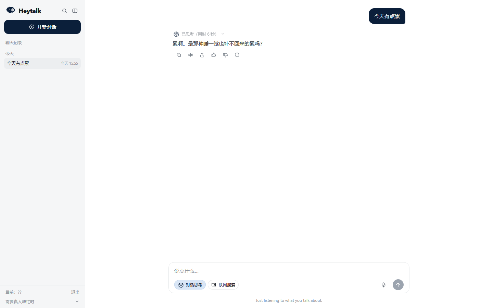
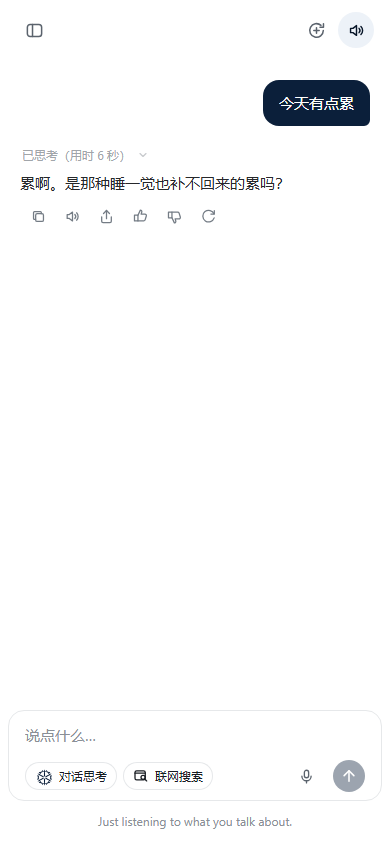

# HeyTalk · 情绪陪伴 Agent

[English](README_EN.md) | **简体中文**

> **在线作品集（先看这个）**：<https://yrd-go.github.io/HeyTalk-Emotional-Companion/showcase/>
>
> GitHub Pages 只承载项目说明、桌面端与手机端截图、架构和演示视频；静态页面不托管模型 Key，
> 也不提供在线聊天后端。

一个把“安全”放在“功能”之前的情绪陪伴对话 Agent。危险信号先经过确定性规则，
高风险输入由固定话术接管；关于用户的长期记忆必须经用户确认后才写入。


## 30 秒了解

| | |
|---|---|
| **项目类型** | 个人作品集与小范围试用原型，不是商业陪伴产品或医疗工具 |
| **技术栈** | React 19 + Vite 前端；Starlette + SSE 后端；Python 规则层 |
| **核心取舍** | 安全判断不交给模型；记忆不悄悄写入；模型不可用时明确降级 |
| **公开作品集** | [GitHub Pages](https://yrd-go.github.io/HeyTalk-Emotional-Companion/showcase/) |
| **验证日期** | 2026-10-26 |

> 演示中的“我不想活了”是**受控安全闸测试输入**，不是真实用户记录。它用于验证高风险
> 输入不会进入普通模型生成。视频与展示页均标注了测试属性。

---

## 本轮真实验证记录

这里只写本轮实际跑过的结果，不把“文件存在”或“代码里写了”当成已验证。

| 验收项 | 本轮结果 | 边界 |
|---|---|---|
| 自动化测试 | **753 项，0 failure，0 error，1 skip** | 主要是 Python、规则层与 HTTP 契约测试 |
| 测试耗时 | 约 281 秒 | 包含真实联网天气与翻译用例 |
| 本机页面 `/app` | HTTP 200，Edge 真实渲染通过 | 当前进入的是登录页 |
| 首屏渲染 | 非白像素 2.435%，构建产物与源码文案一致 | 只证明页面加载和构建一致，不证明全部交互 |
| `/api/bootstrap` | HTTP 200 | 验证页面初始化接口可达 |
| `/api/icon` | HTTP 200，`image/png` | 验证图标资源可加载 |
| `/api/history` | 未登录时 HTTP 401 | 登录保护生效；没有读取任何用户数据 |
| 全球天气 | 实时查询纽约成功 | 测试还覆盖东京、伦敦、巴黎、上海的真实查询，以及北京等地的解析/离线路径 |
| 翻译 | `你好，世界` → `Bonjour, le monde.` | 走 MyMemory，中文到法语 |
| 联网搜索 | 真实返回 3 条搜索结果 | 结果质量依赖搜索引擎，见“已知限制” |
| 导入自检 | 通过 | 可选的 LangChain 模块因未安装而跳过 |
| GitHub Pages | HTTP 200 | 静态作品集可访问 |

**没有写进“已验证”的东西**：

- 没有用真实麦克风重新跑完整 Whisper 识别；本轮只验证了语音接口、错误路径和临时文件清理测试。
- 没有要求面试者复现登录后的每一个点击操作；浏览器本轮验证停在登录页，聊天交互以本机人工演示为准。
- 没有证明 Pro / Flash 或任何模型的回答质量优于其他模型；这不属于本轮测试结论。
- 没有验证 Cloudflare Quick Tunnel 的长期稳定性；它只适合短期试用且地址会变化。
- 没有在全新电脑上重新安装全部 Python / Node 依赖；“本地启动”是作者机器的实际状态。

---

## 作品集内容

### 桌面端



### 手机端



### 演示视频

视频位于 [`showcase/media/heytalk-demo.mp4`](showcase/media/heytalk-demo.mp4)，
也可以在[在线作品集](https://yrd-go.github.io/HeyTalk-Emotional-Companion/showcase/)直接播放。

---

## 已实现并有验证证据的能力

### 1. 确定性安全分流

- 注意力分为 HIGH / MEDIUM / LOW 三级，规则判断发生在模型调用之前。
- HIGH 使用固定处置话术与求助热线，模型调用数为零。
- MEDIUM 的出口会检查求助通道，缺失时自动补上。
- 相关测试：`tests/test_chat_safety.py`、`tests/test_server_api.py`。

### 2. 记忆必须经确认

- 对话中提取到的长期信息只是候选，不直接写盘。
- 用户确认后才进入档案；拒绝、编辑和删除都有独立接口。
- 自动化测试会把历史、反馈和档案目录重定向到临时目录，不碰真实数据。
- 相关测试：`tests/test_server_memory.py`、`tests/test_chat_profile.py`。

### 3. 多用户入口与隔离

- 支持登录、一次性邀请码、令牌吊销、账号与来源双维度登录限速。
- 每个用户有独立历史目录；未登录读取历史会得到 401。
- 当前本机运行状态也实际返回了 401，说明登录保护处于开启状态。
- 相关测试：`tests/test_server_auth.py`、`tests/test_ratelimit.py`。

### 4. 对话接口、SSE 与历史

- `/api/chat` 使用 SSE 流式返回，`/api/history` 加载和删除会话。
- 测试使用替身模型验证流式收尾、错误降级、会话持久化和接口契约。
- 本轮没有用真实付费模型做一次完整问答验收，因此不宣称“真实模型端到端已通过”。
- 相关测试：`tests/test_server_api.py`、`tests/test_chat_conversation.py`。

### 5. 全球天气

- 基于 Open-Meteo，无需 API Key。
- 本轮真实查询纽约成功；测试覆盖中文、英文、国家限定和同名地点消歧。
- 网络不可用时会明确说明，不会把网络故障说成“城市不存在”。
- 相关测试：`tests/test_chat_weather.py`、`tests/test_chat_tools.py`。

### 6. 多语言翻译

- 支持语言解析、语言识别、Google / MyMemory 引擎链和本地缓存。
- 本轮真实完成中文到法语翻译：`Bonjour, le monde.`。
- 翻译会把文本发送给外部翻译服务；只有用户明确要求时才应使用。
- 相关测试：`tests/test_chat_translation.py`、`tests/test_chat_scaffold.py`。

### 7. 联网搜索

- 可从搜索引擎抓取标题、摘要和链接，并格式化后交给生成阶段。
- 本轮真实返回 3 条结果，证明链路可达；其中查询“OpenAI official website”的结果质量不理想，
  因此不把它宣传成可靠的搜索引擎替代品。
- 相关测试：`tests/test_web_search.py`。

### 8. 前端与浏览器呈现

- React 19 + Vite 构建；桌面端与手机端共用一套页面能力。
- 本轮 Edge 无头浏览器实际加载 `/app`，确认页面非白屏、服务端引用的构建资源存在、
  源码文案与构建产物一致。
- 截图中可见登录页、品牌图标、用户名/口令输入和邀请码入口。
- 页面内的逐项点击、音量、朗读、动效等体验以本机人工演示为准，本轮没有完整的浏览器 E2E 断言。

---

## 本地演示

公开的 GitHub Pages 是静态作品集；需要交互时由作者在本地运行。

```powershell
# Python 依赖
python -m venv .venv
.\.venv\Scripts\Activate.ps1
pip install -r requirements.txt

# 前端构建（已有构建产物时可跳过）
cd web
npm ci
npm run build
cd ..

# 环境变量：不要把真实 Key 提交到 Git
copy .env.example .env
# 在 .env 中按需填写模型 Key；不要上传 .env

python src\server\api.py
# 打开 http://localhost:8600/app
```

说明：上述本机启动路径在作者电脑上正在运行；全新电脑的依赖安装没有在本轮重新验收。

---

## 测试

```powershell
python -m unittest discover -s tests -v
python scripts\import_check.py
```

2026-10-26 在最终公开快照中的实际结果：

- `Ran 753 tests in 280.968s`
- `OK (skipped=1)`：没有 failure / error；1 条依赖外部网络或子进程的用例在完整运行中跳过。
- 随后单独重跑翻译 40 项、天气联网 5 项、MCP 探针 7 项、CLI 5 项，均通过。
- 导入自检通过；`langchain_core` 等可选模块按“未安装则跳过”处理。

测试规模不等于产品完整度：753 项主要覆盖规则、后端接口、状态和降级路径，
不覆盖“回答是否讨人喜欢”，也不替代真实用户研究。

---

## 架构与数据流

```text
React 页面
   │  SSE / JSON
   ▼
Starlette API ── 安全规则闸 ── 记忆确认 ── 会话历史
   │
   ├─ 天气：Open-Meteo
   ├─ 翻译：Google / MyMemory
   ├─ 联网：搜索引擎结果页
   └─ 生成：由本地环境决定是否配置模型服务
```

- 高风险输入在生成之前被拦截。
- 普通输入才进入工具和模型阶段。
- 历史、记忆与反馈保存在本地数据目录，并由 `.gitignore` 排除。

---

## 隐私与安全边界

- 不提交 `.env`、API Key、用户对话、画像、反馈、邀请码或会话令牌。
- 公开仓库只包含源码、示例配置、演示素材和脱敏后的评测说明。
- 高风险场景提供真实求助渠道，但本项目不是心理治疗工具，不做诊断、不承诺疗效。
- 天气、翻译和联网搜索会向对应外部服务发送必要的查询内容；不需要外部能力时应关闭相应功能。
- 本仓库不提供公网聊天后端；若他人自行部署，需自行配置 HTTPS、账号和访问控制。

---

## 已知限制

1. **没有真实用户研究**：界面和对话质量依据截图、演示视频与工程测试，不宣称临床或大众产品效果。
2. **没有完整前端 E2E**：本轮浏览器只验证登录页加载与资源一致性，登录后的逐项交互仍需人工点验。
3. **联网搜索质量不稳定**：抓取结果可能离题，也可能被搜索页反爬或限流；失败时会降级而不是伪造结果。
4. **语音没有完整重测**：真实麦克风、模型下载和完整转写不在本次验收范围内。
5. **模型质量未被盲评**：项目的优势是安全与工程约束，不是“回答一定比顶级模型更像人”。
6. **不提供在线交互**：GitHub Pages 是静态作品集，不托管聊天后端。
7. **RAG 向量能力不是主路径**：当前聊天以规则、工具和可选模型为主；向量服务不可用时会退回本地关键词检索。

---

## License

MIT。参见 [LICENSE](LICENSE)。
