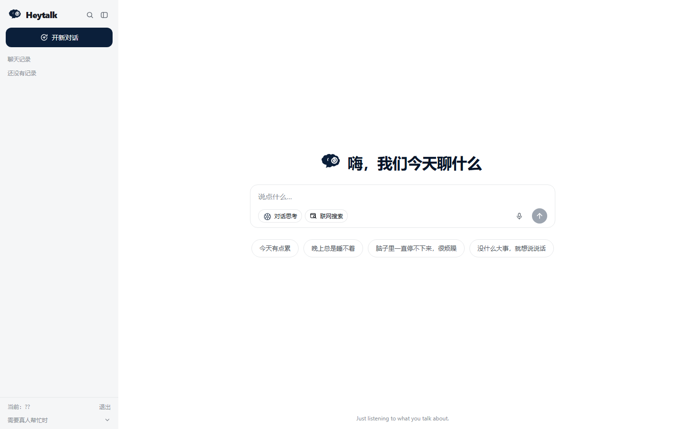

# HeyTalk · 情绪陪伴 Agent

[English](README_EN.md) | 简体中文

> **▶ 在线作品集（建议先看）**：
> https://yrd-go.github.io/HeyTalk-Emotional-Companion/showcase/
>
> 打开即可查看完整演示、能力、架构、证据与边界；不需要下载任何文件。

**一个把"安全"放在"功能"之前的情感陪伴对话 Agent** —— 危险信号走确定性规则而非模型，
危机回应由固定话术接管，关于用户的记忆必须先经他确认才写入。

[](LICENSE)


> **当前状态（2026-10-24）**：功能开发已冻结，定位为个人作品集与小范围试用原型。
> 不把它说成大众陪伴产品，也不按临床产品宣传。技术取舍与边界见
> [CAPABILITIES.md](CAPABILITIES.md) 和 [docs/PITFALLS.md](docs/PITFALLS.md)。

> 🎬 **完整演示**：电脑端与手机端同步展示，包含安全分流、思考流、回复操作与历史。
> 演示直接在 [在线作品集](https://yrd-go.github.io/HeyTalk-Emotional-Companion/showcase/) 内播放。
>
> 演示中的“我不想活了”是**受控安全闸测试输入**，不是真实用户记录。视频画面、字幕和展示页
> 都明确标注了测试属性；它只用于验证高风险输入不会进入普通生成。



---

## 30 秒速览

| | |
|---|---|
| **它是什么** | 可本地运行、也可给朋友短期试用的情绪陪伴对话原型：React 前端 + Starlette/SSE 后端 |
| **最强的地方** | **安全不依赖模型**：危机识别是纯规则，高危时**零模型调用**（有测试钉住） |
| **最诚实的地方** | 有一份[已知限制](#已知限制)：公网隧道会换地址、没有真人用户研究、Pro/Flash 未证明质量差距 |
| **怎么跑** | `pip install -r requirements.txt` → `cd web && npm install && npm run build` → `python src/server/api.py` |
| **一键分享** | `.\scripts\serve_public.ps1`（本机服务 + Cloudflare Quick Tunnel；URL 每次重启会变） |
| **零 Key 也能跑** | 天气（Open-Meteo）、翻译（MyMemory）、危机处置、情绪状态、记忆确认都不需要 API Key |
| **测试** | 775 个测试定义；最近一次全量运行有少量网络/依赖相关失败，不把未验证说成全绿 |

### 为什么这个项目的重点不是"聊得好"

陪伴类产品最容易翻车的地方不是语气，而是**三件被低估的事**：

1. **漏报危机**：把一次真实的求救当成普通抱怨，用户得到的是一段温柔的废话，
   而真正的求助窗口已经关掉了。→ 所以危机识别是**硬规则**，跑在任何模型调用之前。
2. **记错人**：模型从对话里"提炼"出的关于用户的事很容易猜错，
   而一旦写进长期档案，**这个错误会在之后每一次对话里生效**。→ 所以记忆必须**经用户确认**。
3. **说得太亮**：对情绪低落的人，明快高饱和的界面是刺眼的。→ 所以配色保持
   **低饱和 + 不一味冷白**（2026-10 改为天蓝主色 + 海浪渐变，背景仍留一点暖度）。

---

## 目录

- [这个项目是什么 / 不是什么](#这个项目是什么--不是什么)
- [快速开始](#快速开始)
- [系统架构](#系统架构)
- [核心功能：陪伴相关](#核心功能陪伴相关)
- [核心功能：能力相关](#核心功能能力相关)
- [关键工程约束（都有测试钉住）](#关键工程约束都有测试钉住)
- [工程底座：四个已解决的坑](#工程底座四个已解决的坑)
- [测试与自检](#测试与自检)
- [已知限制](#已知限制)
- [部署](#部署)
- [目录结构](#目录结构)
- [安全与隐私约定](#安全与隐私约定)
- [踩坑复盘（21 段）](docs/PITFALLS.md)
- [后续规划](#后续规划)

---

## 这个项目是什么 / 不是什么

**是什么**：一个**能真正跑起来给人用**的情绪陪伴对话 Agent。它的设计重点不是"像人一样会聊"，
而是**在有风险的时候不出错**：

- **确定性安全闸**：三级关注等级（HIGH / MEDIUM / LOW），纯规则实现，零依赖、可离线、可回归测试；
- **危机处置不走模型**：HIGH 时使用固定话术 + 真实求助热线，**一个模型调用都不发生**；
- **记忆要经用户同意**：从对话里提取的关于用户的候选，回述给他确认后才写入；
- **姿态随状态调整**：朋友 / 倾听者 / 良师 / 无条件接纳 / 同行者 / 见证者，切换有安全约束；
- **数据只在你本机**：对话、记忆、反馈全部落在本地文件，可逐条或一键删除。

**不是什么**：

- **不是心理治疗工具，不做诊断**：不出现疾病名称，不判定严重程度，不承诺疗效；
- **不做治疗，也不做治疗性引导**。这一条是**有具体所指**的：对"越难受越想
  要一个确定答案"的人，临床上的正式治疗是不确定性暴露与反应阻止（ERP），
  那是**临床干预**。本项目的做法止于「**验证而非保证**」—— 可以毫不含糊地
  确认"你的感受是有道理的""我不会评判你"，但**不对未来结果做任何担保**。
  一个非临床的 AI 去尝试做治疗，既是越界也是危险的自负。依据见
  [src/chat/persona.py](src/chat/persona.py) 顶部文档（Linton et al. 2012 实验
   + Anthropic 官方说明两处独立来源）。
- **不是高并发生产系统**：定位是"自己用 + 小范围朋友用"；
- **不是模型训练/微调项目**；
- **不替代专业帮助**：设计目标恰恰相反 —— 该转介时**主动**给出真人求助渠道。

> 技术栈：Python 3.10+ · Starlette/SSE · React 19 · Vite · Tailwind CSS ·
> DeepSeek / 智谱 GLM / 本地 Ollama 降级链 · Open-Meteo · MyMemory ·
> 浏览器 SpeechSynthesis · Cloudflare Quick Tunnel。
> LangChain/LangGraph、Chroma、MCP 作为底层演示与历史能力保留，不再是聊天主入口。

---

## 快速开始

### 本地运行（推荐）

```powershell
git clone https://github.com/yrd-go/HeyTalk-Emotional-Companion.git
cd HeyTalk-Emotional-Companion

# 1) Python 依赖
python -m venv .venv-rag
.\.venv-rag\Scripts\Activate.ps1
pip install -r requirements.txt

# 2) 构建 React 前端
cd web
npm install
npm run build
cd ..

# 3) 配置环境变量（不要把真实 Key 提交）
copy .env.example .env
# 编辑 .env；ZHIPU_API_KEY / DEEPSEEK_API_KEY 按实际供应商填写

# 4) 启动
python src\server\api.py
# 浏览器打开 http://localhost:8600/app
```

说明：

- `web/dist/` 是构建产物，已被 Git 忽略；新克隆后必须先执行 `npm run build`。
- 旧的 Streamlit 入口不再是主路径；当前聊天入口是 `src/server/api.py`。
- 只填一组可用的模型 Key 就能跑聊天；天气、翻译、安全闸和记忆确认在没有模型 Key 时也能工作。
- 如果不想配置 Node，可以继续使用已经构建好的 `web/dist/`，但不要把构建产物当作源代码提交。

### 一键分享给朋友

```powershell
.\scripts\serve_public.ps1
```

它会启动本机服务、建立 Cloudflare Quick Tunnel，并打印一个 `https://*.trycloudflare.com` 地址。注意：

- 这是**快速隧道**，每次重启都会换地址；
- Cloudflare 不保证它的可用性；
- 进程还活着，不代表隧道一定健康，必须实际请求 `/app` 或 `/api/bootstrap` 验证；
- `serve_public.ps1` 会自动重启本地服务，但不会保持同一条隧道；cloudflared 退出后要重跑脚本，URL 会变；
- 需要固定地址时，使用 Cloudflare Named Tunnel + 自己的域名。

### 只跑测试或单个模块

```powershell
python -m unittest discover -s tests -v
python src\chat\safety.py
python src\chat\state.py
```

> 项目自带 `.venv-rag/` 是作者本机环境名，脚本会自动探测 `.venv` / `.venv-rag`。
> 所有入口都从仓库根执行，不需要手动设 `PYTHONPATH`。

---

## 托管模式：给几个朋友用（多用户）

默认情况是**本机单人模式**：不用登录，历史写在 `data/chat_history/` 根目录。
一旦配置了用户，服务就进入**托管模式**，行为随之改变 —— 下面这些命令自己会忘，
所以写在这里。

### 一、给自己开一个账号

```powershell
cd <项目根目录>
# 会提示输入口令（不回显、不进命令历史）
.\.venv-rag\Scripts\python.exe scripts\set_user.py add me --name 我
```

> ⚠️ **登录页的「用户名」要填左边那一列（id，如 `me`）**，
> 不是 `--name` 写的显示名。这一点最常被搞混。
> `set_user.py list` 会明确打印"登录时填这个"那一列。

**注意**：配置用户后进入托管模式，**数据按用户分目录**（`data/chat_history/<id>/`），
根目录下已有的记录会"看起来消失"。把它们搬进你自己的目录：

```powershell
.\.venv-rag\Scripts\python.exe scripts\migrate_history.py me --dry-run   # 先看会搬什么
.\.venv-rag\Scripts\python.exe scripts\migrate_history.py me             # 真搬（**先自动备份**）
```

### 二、给朋友开账号 —— 用**邀请码**，你不用经手他的口令

```powershell
.\.venv-rag\Scripts\python.exe scripts\set_user.py invite --name 甲
# → 打印一个一次性码，例如 heytalk-zns2jves
```

把「网址 + 这个码」发给朋友（微信/短信都行）。朋友打开页面 → 点**「开通账号」** →
填码 + 起用户名 + **自己设口令**。**全程你不需要知道他的口令。**

> 为什么不做短信验证码：运营商已不支持对个人用户做短信签名报备
> （腾讯云 2025-09-18 起停止个人自建资质，国内短信只支持公司主体）。
> 详见 `src/server/auth.py` 顶部说明。

配套命令：

```powershell
set_user.py invites            # 每个码用了没有、谁用的
set_user.py uninvite <码>      # 作废一个还没用的码
set_user.py list               # 所有账号 + 令牌状态（含"幽灵条目"）
set_user.py remove <id>        # 删账号（同时吊销他的登录令牌；对话保留）
set_user.py kick <id>          # 让他的登录立刻失效（不改口令）
set_user.py prune              # 清理过期/失效令牌
```

### 二·五、记忆：**它记得你**（但只记你同意记的）

这是这个产品的核心承诺之一，也是**迁移时整块丢掉过的功能**
（React 服务端曾把 `profile_block` 写死为 `None` —— 那一版根本不会记得你）。

1. 你说了一句像长期信息的话（"我在准备考研"）→ 系统只把它当成**候选**；
2. 对话下方出现一张确认卡：**记住 / 改一下 / 不用**；
3. **只有你点了"记住"，它才进档案**，之后聊天时才会带上。

> **为什么这么严**：一条**错的**记忆会在之后的**每一次**对话里持续生效 ——
> 比不记更糟。所以"未经确认不得写入"是红线，有测试守着
> （`tests/test_server_memory.py`）。

**你随时可以删掉它记住的任何东西**（`DELETE /api/profile/{id}`）。
这不是可选项，是尊严问题，也是合规问题。

### 二·六、"回顾"：偶尔提一件你之前说过的事

打开时**偶尔**会出现一条低调的提示，例如：

> 你之前说过「在准备考研」。后来有进展吗？

它**不是推送**。四道闸门全在服务端判（`src/chat/review.py`）：

| 闸门 | 规则 |
|---|---|
| 内容闸 | 必须有**你确认过的**记忆，且类型值得追问（目标/事件/关系；偏好与事实不问） |
| 时间闸 | 距上次 ≥ 7 天 |
| 场景闸 | 只在**新会话的空屏**上出现，不打断当下 |
| **注意力闸** | ★ **上次没被点开 → 间隔拉长到 30 天**（防习惯化：你的沉默就是"少打扰我"的信号） |

外加**永久关闭**：点一次"以后不用提醒我这些"，就再也不出现。

> **为什么不"不可预测地发一封信"**（这曾是最初的设计，被证据否掉了）：
> PLOS ONE 的随机对照（n=77，doi 10.1371/journal.pone.0169162）发现
> **"智能择时"相对固定定时没有显著优势** —— 为"不可预测"付出的复杂度
> 买不到收益；而"不可预测的奖励"在机制上是老虎机式的变动比率强化。
> 完整的证据与取舍写在 `src/chat/review.py` 顶部。

### 二·七、语音输入（本地识别，**录音不出这台电脑**）

输入框右侧的麦克风按钮：说话 → 本机识别 → 文字进输入框。

- **本地识别**用 `faster-whisper`，音频**不发给任何第三方**
  （浏览器自带的语音识别会把音频送到 Google，所以没用它）
- 录音写临时文件、识别完**立刻删除**（有测试守着"失败路径也要删"）
- 首次使用需要**联网下载一次模型**（约 460MB）到 `models/`（已 gitignore）。
  中国大陆访问 huggingface.co 常常不通，代码会**自动探测并改用镜像**
  `hf-mirror.com`，同时关掉 Xet（镜像不代理 Xet 的 CAS 服务器）
- **麦克风需要 HTTPS 或 localhost**（浏览器强制）。走 `http://内网IP` 时
  网页录音不可用 —— 手机系统键盘自带的语音输入不受此限制

### 三、让朋友连进来

默认只监听本机。两种联网方式：

| 方式 | 朋友要做什么 | 你要做什么 | 暴露面 | 麦克风 |
|---|---|---|---|---|
| **公网隧道**（推荐） | **点一个网址** | 跑 `scripts/serve_public.ps1` | 只暴露一个地址 | ✅ 有 HTTPS 才可用 |
| 局域网 | 同一 WiFi 下输入你的内网 IP | `$env:HEYTALK_HOST="0.0.0.0"` 后重启 | **整个局域网可见登录页** | ❌ 浏览器拒绝麦克风 |

#### 一键启动（推荐，别手工起两个进程）

```powershell
cd <项目根目录>
.\scripts\serve_public.ps1
```

**它会做三件事**：起本机服务 → 建公网隧道 → **把网址打出来给你复制**。

```
====================================================================
  发给朋友的网址：

    https://xxxx-xxxx-xxxx.trycloudflare.com

  注意：这个地址**每次重启都会变** —— 重启后请重新复制。
====================================================================
按 Ctrl+C 停止（两个进程会一起关掉）。
下面每 30 秒检查一次服务状态。
```

**它为什么要存在**（来自一次真实的 502 事故）：
手机上看到的是 Cloudflare 的 `Bad gateway`，而**那个报错完全看不出
"是你本机服务没开"** —— 指向的是 Cloudflare，不是真正的原因。
所以脚本加了**健康检查循环**：服务挂了**自动拉起**，并明确报告：

```
[20:31:28] 服务无响应，正在重启…
[20:31:28] ok 服务已恢复
        网址没变，朋友那边刷新即可。
```

**服务崩了，朋友的网址不用重发**（cloudflared 会重连 origin）。

参数：

```powershell
.\scripts\serve_public.ps1 -NoTunnel          # 只起本机服务
.\scripts\serve_public.ps1 -Port 8700         # 换端口
.\scripts\serve_public.ps1 -HealthEverySec 15 # 健康检查间隔
```

> ✅ **本机地址 `127.0.0.1` 与 `localhost` 都可以用。**
> 服务默认绑 `localhost`，会**同时监听 IPv4 与 IPv6 回环**
> （实测 `Get-NetTCPConnection` 同时列出 `::1` 与 `127.0.0.1`，
> 三种写法都返回 200；这两个都**只在本机**，不会暴露给局域网）。

> ⚠️ **这个脚本不会开机自启**，也不会在电脑休眠/换网后自动恢复 ——
> 它只保证"**进程崩了能自己爬起来**"。要开机自启得另配计划任务
> 或把 cloudflared 装成系统服务。

#### 局域网方式（不开隧道）

```powershell
$env:HEYTALK_HOST = "0.0.0.0"
.\.venv-rag\Scripts\python.exe src\server\api.py
```

> **为什么麦克风那一列重要**：浏览器强制要求**安全上下文**（HTTPS 或 localhost）
> 才允许访问麦克风。走 `http://内网IP` 时网页内的录音按钮**不可用**
> （手机系统键盘自带的语音输入不受此限制，它走的是系统服务）。

### 五、隔离验证（开发用）：别拿真实数据做实验

```powershell
$env:HEYTALK_DATA_DIR = "C:/tmp/heytalk-probe"   # 数据全落到临时目录
$env:HEYTALK_PORT = "8601"                       # 换个端口，和主实例并存
.\.venv-rag\Scripts\python.exe src\server\api.py
```

这条**不是可选项**：`data/` 里有真实对话（含高度敏感内容）。
我早期跑临时探针时就把测试会话写进了真实历史目录，事后手工清理 ——
那种"事后补救"迟早会出错。做任何实验都用这个隔离实例。

### 六、这些文件都在 `.gitignore` 里（含凭据，绝不能提交）

```
data/users.json       # 用户与口令哈希（PBKDF2 + 每用户独立盐）
data/sessions.json    # 已签发的登录令牌
data/invites.json     # 一次性邀请码及使用记录
```

---

## 系统架构

### 一轮对话的完整流程

```mermaid
graph TD
    U[用户输入] --> GUARD{安全闸<br/>纯规则·零依赖}
    GUARD -->|HIGH| FIXED[固定话术 + 真实热线<br/>★ 零模型调用]
    GUARD -->|MEDIUM / LOW / NONE| STATE[更新情绪状态<br/>valence/arousal/dominance…]

    STATE --> ROLE[姿态路由<br/>朋友/倾听者/良师/接纳/同行/见证]
    STATE --> PROF[读取已确认的记忆]
    STATE --> KB{用户在问「怎么做」?}
    KB -->|是| HAND[检索情绪自助手册]
    KB -->|否| SKIP[不检索]

    ROLE --> TOOLS{需要工具?}
    PROF --> TOOLS
    HAND --> TOOLS
    SKIP --> TOOLS
    TOOLS -->|天气/翻译/联网搜索| ENG[Open-Meteo / 多引擎翻译 / Web Search]
    TOOLS --> LLM[流式生成回应]
    ENG --> LLM
    LLM --> MED{中危?}
    MED -->|是| RES[出口校验：必须带求助通道]
    MED -->|否| OUT[回应]
    RES --> OUT

    OUT --> SAVE[落盘：对话 + 状态]
    SAVE --> EXTRACT[提取记忆候选]
    EXTRACT --> CONFIRM[回述确认卡<br/>对 / 改一下 / 不用记]
    CONFIRM -->|确认或修正| WRITE[(写入记忆)]
    CONFIRM -->|不用记| DROP[丢弃，并记录一次"猜错"]

    FIXED --> SAVE
```

### 记忆与知识分成两类（这是有意的）

| | 关于**这个人** | 关于**世界** |
|---|---|---|
| 模块 | `src/chat/profile.py` | `src/chat/knowledge.py` |
| 内容 | 在准备考研、和母亲关系紧张、不喜欢被追问原因 | 呼吸法、睡眠卫生、拖延、考试焦虑、何时求助 |
| 数据源 | 用户确认过的条目（本机 JSON） | `data/emotional_handbook.txt`（25 条） |
| 写入 | **必须经用户确认** | 不需要（与个人无关） |
| 检索 | 按当下语境挑相关条目 | 按关键词 + 状态加权，且**只在用户问"怎么做"时** |

---

## 核心功能：陪伴相关

### 1. 安全闸：三级关注等级（`src/chat/safety.py`）

纯规则实现，**不依赖模型是否可用**（无 Key、断网、模型挂了，安全闸照样工作）。

| 等级 | 触发 | 处置 |
|---|---|---|
| **HIGH** | 明确的自伤/自杀意图、计划、手段、告别式表达 | **固定话术 + 热线 + 急救引导；零模型调用** |
| **MEDIUM** | 无望、成为负担感、情感麻木、持续睡眠/进食问题 | 允许模型参与，但**出口校验必须带求助通道**，缺则自动补上 |
| **LOW** | 一般负向情绪（需 ≥2 次命中，避免噪音） | 正常对话 + 轻量关心 |

几个刻意做对的地方：

- **否定只在当前分句生效**：`我不会自杀，但我真的不想活了` 必须仍判为 HIGH
  （早期版本让逗号前的"不"跨句压掉了后半句的真实求救，这是最坏的一类漏报）；
- **命中原文不进上下文**：`SafetyHit` 只保留规则 id 与位置，**不保存用户原文**，
  避免自伤表述被二次拼进 Prompt、写进日志或渲染到页面；
- **宁可误报**：日常口语（"笑死""累并快乐着""不想上班"）通过词组边界压低误报，
  但安全侧接受少量误报 —— 误报只是多说一句关心。

### 2. 情绪状态：双轨制（`src/chat/state.py`）

八个维度（valence / arousal / dominance / energy / social_support / self_worth /
alliance / disclosure），全部钳制在 `[0,1]`，带平滑与单轮位移上限。

- **规则轨**：词典 + 否定/强度修饰 + 会话内趋势，**永远可用**（无 Key 也能更新状态）；
- **模型轨**：可选，严格 JSON 契约，解析失败自动回落规则轨；
- **分歧时以规则轨为安全下界**，且**风险等级只允许来自 safety.py**，不接受词典打分或模型输出；
- **持续下滑识别**：末尾连续不升 + 累计跌幅达标即标记 —— 这一条修过一个真 bug：
  早期每步阈值定得比平滑后的实际跌幅还高，导致"缓慢恶化"**永远触发不了**，
  而那恰恰是陪伴场景里最危险的情形。

### 3. 记忆：提取 → 回述确认 → 才写入（`src/chat/profile.py`）

**红线：绝不保存系统自己推断出来的关于用户的事。**

流程：从对话里提取候选 → **回述给用户**（"要不要记住这件事？"）→
三个动作：**对，记下来 / 改一下再记 / 不用记**。只有前两个会写盘。

- 用户改了措辞就以**他的话为准**（并标记为更可信）；
- "不用记"会记下一次 `rejected`，用于统计**系统猜错率**；
- 侧边栏可逐条删除、可全部清空；档案统计里 `accept_rate` / `wrong_rate`
  是将来做**消融实验**（有确认门控 vs 无门控）的量化依据。

### 4. 姿态路由：状态 + 明确诉求 → 说话方式（`src/chat/roles.py` + `role_router.py`）

六个姿态，每个都带**准则**与**禁止项**（是可判定的是非句，不是形容词）。
判定顺序：**只想倾诉 → 请求建议 → 取得进展 → 自我否定 → 焦虑迷茫 → 默认朋友**。

三条安全约束（都有测试）：

1. **高危/中危时角色机制完全停用** —— 绝不允许"因为你自责，所以我用严厉的良师纠正你"；
2. **不对称原则** —— 低置信度只允许切到更温暖的角色，**永不**切到权威角色（良师/接纳）；
3. **许可优先于推断** —— 权威角色必须由用户**明确求教**触发，不由情绪推断。

### 5. 角落的陪伴小动物（`src/chat/character.py`）

六个形象（小熊 / 猫 / 猫头鹰 / 母鸡 / 狐狸 / 小鸟），随姿态变化。手写 SVG，无图片文件。

**只允许三种状态，且都不带索取**：做自己的事、被点一下（吃惊地跳一下）、久不互动就睡着。
刻意**没有**"期待 / 失落 / 委屈 / 在努力等你"——

> 一个角色在用户没理它时显得委屈，传递的是"它有需求没被满足，而满足它是你的责任"。
> 对正在低落、自责的人，那最可能的感觉是愧疚。所以这条用 17 个禁用词扫描**渲染输出**钉死。

### 6. 反馈埋点：让"有没有帮到人"可测（`src/chat/feedback.py`）

每 3 轮在最后一条回答下方问一次（可跳过）：**有帮到 / 说不好 / 没帮到**。
同时记录**该轮前后的情绪变化**作为客观交叉验证，以及**当时用的姿态**——
这样"哪个姿态真的有用"是一个可算的数字，而不是感觉。

统计口径上有一条刻意：**"说不好"绝不算成"没帮助"**（把中性计成负面是最常见的自欺口径）。

---

## 核心功能：能力相关

### 7. 全球实时天气（`src/chat/weather.py`）

- 数据源 **Open-Meteo**：**全球任意城市**，实时 + 16 天预报，来自 17 家气象局（含中国 CMA、美国 NOAA、日本 JMA）；
- **不需要 API Key**；自带地名解析，中文/英文/当地写法都能查（实测 New York / 東京 / London）；
- ⚠️ 授权是 **"Free for non-commercial use"** —— 毕业设计/自用没问题，商业化需换源；
- 降级链：Open-Meteo → **本地 MCP 模拟服务端**（明确标注"这是模拟数据"）→ 一句可读说明。

### 8. 多语言翻译（`src/chat/translation.py` + `languages.py`）

| 层 | 说明 |
|---|---|
| 语言注册表 | **约 90 种语言**，支持**代码 / 中文名 / 英文名 / 当地写法**四种写法（`ja` = `日语` = `Japanese` = `日本語`） |
| 源语言识别 | 按**书写系统**判断 —— 韩文/日文/阿拉伯文/泰文以前全被当成英语，现在认得出来；日语只要有假名就判为日语 |
| 引擎链 | Google Cloud（配 Key 时，130+ 语言）→ MyMemory（免费、免注册）→ **明确说"翻不了"，绝不编答案** |
| 缓存 | 同句不重复翻（Google 按字符计费，这条直接省钱） |
| 上限 | 单次 4000 字；超长**明确拒绝而不是偷偷截断** |

**Google Cloud Translation 的价格**（写在这里省得你查）：标准 NMT **$20 / 百万字符**，
**每月前 50 万字符免费**。据估算，个人每天翻 50 句短句 ≈ 每月 3 万字符，**在免费额度内**。

### 9. 情绪自助手册检索（`src/chat/knowledge.py`）

25 条**可操作**条目，分 6 章（身体调节 / 情绪当下 / 具体困扰 / 自我相处 / 关系 / 何时求助）。
写作纪律：不写"你应该"、不承诺疗效、不含诊断词、每条都要有**具体动作**（有测试钉住）。

**只有当用户明确问"怎么做"时才检索** —— 这是与"不主动给建议"原则的接线处：
检索得到 ≠ 应该给。

### 10. 前端与语音交互（2026-10）

- 输入框内并列“对话思考”和“联网搜索”两个模式胶囊，激活/未激活状态用底色和文字色区分；
- 回复下方提供复制、朗读、转发、赞同、反对、重新生成六个操作；
- 顶部音量开关控制全局朗读；关闭后，单条回复的朗读按钮也会禁用；
- 朗读使用浏览器 `SpeechSynthesis`，优先选择自然男声并按句子切段，适配手机浏览器；
- 推荐话题由最近对话动态生成，不是固定文案；桌面端与手机端共用同一套能力；
- 聊天内容向上滚动后出现“回到底部”按钮；开场动效只播放一次，并支持 `prefers-reduced-motion`。

---

## 关键工程约束（都有测试钉住）

这一节是这个项目最值钱的部分：**下面每一条都不是文档承诺，而是有测试失败风险的约束。**

| 约束 | 被什么钉住 |
|---|---|
| 高危时**零模型调用、零工具调用** | 给 `make_model` 装哨兵，跑完整 HIGH 流程断言调用记录为空 |
| 高危**绝不经过翻译/工具**（不把自伤表述发往外部服务） | `plan_reply` 先于工具阶段；页面级测试验证 |
| 危机回应不用模型自由发挥 | HIGH 分支直接返回固定话术，`blocks_freeform_llm` 为真 |
| 中危回应**必须**含求助通道 | 出口校验：模型没给就自动补上 |
| 记忆**未经确认不写盘** | 页面级测试：说完长期信息后断言档案文件**不存在**；点"不用记"后条目数不变 |
| 界面**不出现**「AI 助手 / 智能体 / 请描述你的问题」 | 文案禁用词扫描（用户明确要求：这类词影响情绪体验） |
| 开场必须短 | 去空白标点后 ≤ 20 字 |
| 背景不纯白、正文对比度达 WCAG AA、主色与白字对比够 | 主题断言：背景非纯白/非纯冷蓝；正文对比度 ≥ 4.5:1；主色 ≥ 3:1 |
| 海浪渐变必须顺滑（多层径向，不许线性） | CSS 断言：radial-gradient ≥ 3 层、无 linear-gradient、只在浅色模式生效 |
| 小动物**不含索取式行为** | 17 个禁用词扫描**渲染输出**；状态白名单只有 idle/happy/sleeping |
| 手册里的求助号码与 `safety.HOTLINES` **完全一致** | 号码一致性断言 —— 写错号码比不写更危险 |
| 工具**永不抛异常**（超时/断网/参数错都给可读结果） | 畸形输入逐项断言 |
| 威胁测试不污染真实数据 | 页面级测试把历史/反馈/档案目录重定向到临时目录 |

---

## 工程底座：四个已解决的坑

聊天 Agent 不是凭空写的 —— 它建在这个仓库原有的工程能力上。这些能力现在是**底层支撑**，
仍然可独立运行、独立评测（也是当初的 21 段复盘与实测截图的来源）。

### ① 模型不可用 → 生成阶段主备降级 + 快速失败

智谱 GLM-4-Flash 超时/限流/鉴权失败时自动切本地 Ollama；`--engine zhipu` 或 `--no-fallback`
则**快速失败**（退出码 2）而不是静默降级。实测：智谱超时后切 Ollama 72 秒返回；
严格模式立即报错。

### ② 向量空间错配 → 元数据一致性守卫 + 一条命令修复

向量库里记录了建库时的 `embedder`。切换 Embedding 引擎时**拒绝**在旧向量空间上检索
（否则返回语义错乱的垃圾结果），并提示 `--rebuild`。踩过的报错：
`Collection expecting embedding with dimension of 2048, got 768`。

### ③ 协议线污染 → stdout/stderr 纪律 + 可复现故障的探针

stdio 传输下 **stdout 就是协议线**，任何 `print()` 都会污染 JSON-RPC 报文。
仓库里有一个**专门用来复现这个故障**的开关（`MCP_POLLUTE_STDOUT=1`）与旁路探针
（`--break-stdout`），把"排障路径"本身也做成可验证的。

### ④ 检索不可用 → 本地关键词召回兜底（零外部依赖）

Embedding 接口 401/超时时降级到本地分词 + IDF 打分：实测 **0.29 秒**返回，Top-4 全部命中。
这条降级链修过一个经典 bug：`retrieve()` 内部用 `die()` 抛的是 **`SystemExit`**，
而 `except Exception` **抓不到它** —— 降级代码等于白写。
（教训：**兜不住的兜底比没有兜底更危险**，因为它给你"已经兜住了"的错觉。）

### 附：RAG 演示仍可单独评测

```bash
python src/rag_demo.py "我一焦虑就胸口发紧"              # 向量 + 关键词混合检索 + 双引擎生成
python src/rag_demo.py "我一焦虑就胸口发紧" --keyword-only  # 零依赖：只走本地关键词召回（连 Key 都不用）
python src/rag_demo.py --rebuild                          # 重建向量库（切换 Embedder 必须重建）
python scripts/eval_rag.py                                # 18 题检索评测 → hit@1 / hit@3 / MRR
```

评测（18 题 · 针对**情绪手册** · 关键词检索）：

```
hit@1 = 0.778   hit@3 = 0.944   hit@5 = 1.000   MRR = 0.863   未命中 0 / 18
```

Agent 实际把 top-3 交给模型，所以 `hit@3` 是功能上的关键数字。
口径与失败案例见 [data/eval/README.md](data/eval/README.md)。

> ⚠️ **向量库当前不可用（环境问题，已在已知限制里记录）**：
> 旧的 IT 手册向量库已随语料删除；重建时 **chromadb 1.5.9 在这个环境报
> `unable to open database file (code 14)`**，而原生 sqlite3 建库正常 ——
> 说明是 chromadb 与当前环境不兼容，不是代码问题。
> 因此 `rag_demo` 的**向量检索路径暂时跑不了**；上面的评测走的是关键词检索，不受影响。

---

## 测试与自检

```powershell
python tests\run_all.py                   # 全量测试（受限环境也能用）
python -m unittest discover -s tests -v   # 标准入口
python scripts\import_check.py            # 跨目录 import + 路径常量自检
python scripts\health_check.py            # 目录 / 硬编码路径 / 导入 / 启动烟雾
```

**测试规模**：当前有 775 个测试定义。最近一次全量运行记录了少量网络/依赖相关失败，
所以文档不写“全部通过”；请以实际命令输出为准。无网环境下的用例会 SKIP 并打印原因，
不伪装成通过。

| 文件 | 防的是什么回归 |
|---|---|
| `tests/test_chat_safety.py` | 高危漏报；否定词跨句生效；日常口语误判；命中原文进入结果 |
| `tests/test_chat_state.py` | 状态越界；持续下滑识别失效；保存用户原文 |
| `tests/test_chat_profile.py` | 记忆未经确认就写盘；被拒绝候选进入档案；留言未脱敏 |
| `tests/test_chat_conversation.py` | 中断回复进入上下文；模型路由/降级异常；工具阶段被绕过 |
| `tests/test_chat_weather.py` | 离线降级未标注；联网失败未优雅降级；WMO 映射缺项 |
| `tests/test_chat_translation.py` | 降级链断裂；语言识别退化；超长文本被偷偷截断 |
| `tests/test_server_api.py` | SSE、历史、静态资源、API 契约回归 |
| `tests/test_server_auth.py` | 多用户隔离、邀请码一次性、幽灵令牌 |
| `tests/test_server_memory.py` | 主链路记忆门控被绕过 |
| `tests/test_capabilities.py` | 前端迁移后能力漏接线 |
| `tests/test_web_search.py` | 联网搜索参数、失败降级、结果格式化 |
| `tests/test_ratelimit.py` | 登录限速的账号/来源两个维度 |
| `tests/test_transcribe.py` | 本地语音识别失败路径与临时文件清理 |

CI：`.github/workflows/ci.yml` 在 Python 3.10 / 3.12 上跑单元测试 + 导入自检。

---
## 已知限制

诚实清单 —— 这些都是**尚未完成或实测不足**的地方，不要按已完成理解：

### 与陪伴 Agent 相关

1. **纯字面检索有天花板**：情绪手册检索用"停用词过滤 + IDF 加权 + 同义词扩展"，
   但实测**相关查询最低分 0.298、无关查询最高分 0.320，有约 0.02 重叠**，单一阈值分不干净。
   典型误命中："明天天气怎么样"会碰到"考试焦虑"。缓解措施：只有用户问"怎么做"时才检索，
   且命中内容在提示里标注为"可忽略的参考"。
2. **存在字面解不开的歧义**：例如"我想找人帮忙"到底是帮自己还是帮朋友 ——
   同一句话两种情况都成立，所以它命中不了"找咨询师"那条。这不是调权重能解决的。
3. **情绪状态是规则驱动的估计，不是心理测量**：八维度值只用于调整语气，
   没有与任何量表做过效度验证；**不应被当作测度使用**。
4. **记忆提取偏"明确陈述"**：规则轨只抽第一人称的长期陈述（"我在准备考研"），
   对隐含信息（语气、回避的话题）不提取 —— 这是刻意的，避免"背后分析用户"。
5. **没有真人用户研究**：所有关于"有没有帮到人"的结论都还只有自陈反馈，
   没有对照组、没有伦理审查、样本量为零。
6. **姿态路由的规则是手工拟的**：六个姿态的边界文本有测试保证完备性，
   但"哪个姿态更适合哪种状态"没有实证依据。
7. **单会话内存态**：服务端会话在进程重启或长时间空闲后失效；
   对话会落盘并可按会话 id 恢复，但同一浏览器的多个标签页会共用一条会话。

### 与工程底座相关

8. **检索兜底是"关键词级"**：精度不如向量召回（关键词兜底 hit@1 0.900 vs 默认链路 0.975）；
   真正的"向量级兜底"尚未实现。
9. **没有退避 / 抖动 / 熔断 / 时间预算**：实现的是主备切换 + 快速失败，不是完整容错链路。
10. **评测只覆盖检索与"可核对性"**：**答案正确性**（是否真的解决了用户问题）还没有
    LLM 评审或人工标注，Token 成本也未纳入同一条命令；40 题来自单一知识库，结论不宜外推。
11. **MCP 探针未断言控制帧**：`initialized` / `ping` / `progress` / `cancellation` 尚未逐项断言。
12. **Docker 镜像内没有 Ollama**：容器里 `OLLAMA_BASE_URL` 指向容器自己；要在容器内演示降级
    需另起 Ollama 容器并改环境变量。
13. **公网 Demo 的模块 ③/⑤ 在无 MongoDB 时走 mock**：会明确标注 `[mock]`，
    需要真实数据请配置 `MONGO_URI`（推荐 Atlas）并把 `STUDENT_ALLOW_MOCK=false`。
14. **公网分享依赖 Cloudflare Quick Tunnel**：进程活着不等于隧道健康，重启后 URL 会变化；
   Cloudflare 不保证 uptime。日志出现 `Unauthorized: Tunnel not found` 时，旧隧道已经失效，
   需要重启 cloudflared 并重新验证 `/app` 与 `/api/bootstrap`。固定地址需要 Named Tunnel + 域名。

---

## 部署

### 本地（推荐）

```powershell
cd <项目根目录>
.\.venv-rag\Scripts\python.exe src\server\api.py
# 浏览器打开 http://localhost:8600/app
```

数据落在 `data/` 下的 `chat_history/`、`feedback/`、`profile/`，默认只在本机。
这些目录已经在 `.gitignore` 中忽略，不要提交真实对话或用户档案。

### 给朋友短期试用

```powershell
cd <项目根目录>
.\scripts\serve_public.ps1
```

脚本会启动本机服务和 Cloudflare Quick Tunnel，并打印公网地址。请注意：

- Quick Tunnel 的 URL 每次重启都会变化；
- Cloudflare 不保证 uptime；电脑休眠、换网、进程退出都会让朋友访问失败；
- 进程活着不等于隧道健康，必须实际请求 `/app` 和 `/api/bootstrap`；
- 登录页会暴露在公网，邀请码要一次性使用，不要公开发送。

### 固定地址（可选）

如果确实需要稳定 URL，需要 Cloudflare 账号、自己的域名和 Named Tunnel。Quick Tunnel 只适合短期测试，不适合作为正式服务。

### 旧文档说明

根目录的 `DEPLOY.md` 与 `DEPLOY_STRUCTURE.md` 记录的是 Streamlit Cloud 时代的部署方式，只作为历史参考。当前主入口是 `src/server/api.py` + React `web/dist/`。

---
## 目录结构

```
my-agent/
├─ README.md / README_EN.md    # 中文主文档 / 英文旧版（待同步）
├─ CAPABILITIES.md             # 前端迁移时必须逐项验收的能力清单
├─ requirements.txt
├─ .env.example                # 环境变量模板，不含真实 Key
├─ src/
│  ├─ paths.py                 # 路径 / 环境变量 / 脱敏
│  ├─ server/                  # HTTP 层
│  │  ├─ api.py                #   Starlette + SSE + 静态资源
│  │  ├─ auth.py               #   登录 / 邀请码 / 会话
│  │  ├─ ratelimit.py          #   登录限速
│  │  └─ transcribe.py         #   本地语音识别
│  └─ chat/                    # 产品本体，不依赖界面框架
│     ├─ safety.py             #   硬规则安全闸（先于模型）
│     ├─ state.py              #   情绪状态
│     ├─ profile.py            #   确认式记忆
│     ├─ review.py             #   回顾
│     ├─ role_router.py        #   姿态路由
│     ├─ persona.py            #   提示词边界
│     ├─ conversation.py       #   会话 / 模型路由
│     ├─ history.py            #   历史持久化
│     ├─ feedback.py           #   反馈
│     ├─ weather.py            #   天气工具
│     ├─ translation.py        #   翻译
│     ├─ web_search.py         #   联网搜索
│     ├─ opening_topics.py     #   动态推荐话题
│     └─ tools.py              #   工具封装
├─ web/
│  ├─ src/                     # React 19 + Vite + Tailwind
│  │  ├─ App.tsx
│  │  ├─ useChat.ts
│  │  ├─ speech.ts
│  │  └─ components/
│  └─ dist/                    # 构建产物，已 gitignore
├─ data/
│  ├─ emotional_handbook.txt   # 情绪自助手册
│  └─ eval/                    # 检索与对话评测集
├─ reports/                    # 本地评测报告（已 gitignore）
├─ docs/
│  ├─ PITFALLS.md              # 踩坑复盘
│  └─ images/
├─ tests/                      # Python 测试（775 个定义）
└─ scripts/
   ├─ serve_public.ps1         # 本机服务 + Cloudflare Quick Tunnel
   ├─ smoke_frontend.py        # 白屏检测
   └─ eval_*.py                # 评测脚本```

> `data/chat_history/`、`data/feedback/`、`data/profile/` **不在仓库里**：它们是运行时数据，
> 已在 `.gitignore` 忽略，属于你和这台机器之间的东西。

> **`AGENTS.md` 是什么**：本项目的 **AI 协作规范（元规则层）** —— 只写全局底线
> （先出计划再动手、密钥只走环境变量、禁止直接执行破坏性操作），具体技术约束放在每次任务的
> Prompt 里。把「元规则」与「任务规则」分开，是为了避免上下文污染导致指令遵循率下降
> （复盘见 [docs/PITFALLS.md 第 8 节](docs/PITFALLS.md)）。

---

## 安全与隐私约定

### 数据只在你本机

| 数据 | 位置 | 说明 |
|---|---|---|
| 对话历史 | `data/chat_history/*.json` | 每个浏览器会话一个文件，默认 **30 天**自动过期 |
| 反馈记录 | `data/feedback/feedback.jsonl` | 追加式；留言过一遍脱敏 |
| 关于你的记忆 | `data/profile/profile.json` | **只存你确认过的**条目 |

三者都在 `.gitignore` 中，**提交不到任何地方**。侧边栏可逐条删除、可全部清空
（"全部清空"是真的删文件，不是只清界面）。

### 密钥与凭据

- `.env` 已被 `.gitignore` 忽略，**绝不提交**；`.env.example` 只放占位符；
- 密钥只通过 `os.environ` 读取，**不打印、不回显、不写日志**；
- 需要打印连接串时**必须**经过 `paths.mask_uri()`（只保留 scheme / 主机 / 库名）；
- 页面渲染任何输出前统一过 `paths.mask_secrets()`（连接串 / `sk-` Key / Bearer 令牌 / `key=value`）；
- 测试里有一条**源码级断言**：`src/**/*.py` 中不得出现敏感值的裸插值。

### 响应速度（2026-10-16 起）

- **思考过程实时可见**：DeepSeek 的 `reasoning_content` 以 `thinking` 事件流到前端，
  等待期显示「正在思考… Ns」与可折叠思考过程（官方 App 的 "Thought for Xs" 同款交互）。
- **分任务路由**：默认对话和联网检索走快速引擎；用户显式开启「对话思考」时才切推理引擎。
  查询/工具类任务不再额外付一轮推理成本；可用 `HEYTALK_AUTO_ROUTING=0` 关闭自动路由。
- 工具判定（`run_tool_phase`）同样用快速引擎，不再让每句话先付一轮 Pro 思考。

### 边界

- **不做诊断、不承诺疗效**，输出带明确的非专业帮助声明；
- **不做治疗，也不做治疗性引导**：止于「验证而非保证」—— 确认感受可以毫不
  含糊，担保结果一律不许（临床上的不确定性暴露/ERP 属临床干预，本项目不碰）。
- **模型选择是有取舍的**：主用 DeepSeek，智谱 GLM 与本地 Ollama 降为
  **隐藏备用**（只在主用不可用时自动顶上，并如实告知用户当前是降级状态）。
  依据是一次实测对照（同一提示词、10 条覆盖闲聊/低落/报喜/提问的输入）：

  | | 空头保证 | 反问率 | 问句附"不回答的权利" |
  |---|---|---|---|
  | DeepSeek Flash | 0/8 | 1/8 | 1/1 |
  | 智谱 GLM 免费版 | 0/8 | **7/8** | **2/7** |

  即：**GLM 能遵守"不许说某些话"（禁止清单），但遵守不了"少问、且问就给许可"
  这类行为规则**。它的短板在**质量**不在**安全** —— 安全属性是代码级硬规则，
  不依赖模型，所以弱模型破坏不了安全底线。正因如此它是"降级备用"而非"删除"：
  删掉会同时失去降级链。
- **危机场景人机接力**：HIGH 时给出真实热线（12356 / 北京市心理援助热线）
  与 120 / 110 引导，并明确建议找真人；
- **翻译会把那段文字发到外部服务**（这是它的工作方式）。所以：只在用户明确要求翻译时才发，
  且**高危内容永远不经过任何外部服务**。

---

## 踩坑复盘（21 段）

从沙箱拦截、模型代码幻觉、字符集编码冲突，到向量空间冲突、双引擎容灾演练、MCP 协议线污染，
完整的过程记录与实测截图在 **[docs/PITFALLS.md](docs/PITFALLS.md)**。

其中最值得一读的是**第 21 节**：作者引以为傲的"查询改写 + 混合重排"，
一上 40 题评测被发现是**负优化**（hit@1 0.725，低于纯向量检索的 0.925）。
修掉两个根因后升到 0.850，仍不及纯向量；最终把那个"亮点"降级成了默认关闭的开关。

> 这条教训贯穿了整个聊天 Agent 的设计：**没有评测的"优化"就是自说自话**。
> 所以危机识别有漏报测试、记忆有"未经确认不写盘"的测试、
> 检索有"无关问题不该命中"的测试 —— 都是为了让"我觉得更好"无法蒙混过关。

---

## 项目状态与后续

**功能开发已冻结（2026-10-23）。** 项目保留为个人作品集、工程复盘和小范围试用原型，不再以“新增功能”作为默认方向。

后续只做三类事情：

- **维护**：修复安全、登录、数据丢失和启动问题；
- **文档**：保持 README、能力清单、演示说明和运维说明与代码一致；
- **验证**：如果重启开发，先做真实用户验证，而不是继续堆提示词和功能。

如果未来重启，唯一值得先验证的是：

1. 10–20 个真实用户、两周使用；
2. 与“通用 LLM + 简单提示词”做盲评；
3. 主指标是第 7 天回访率、被听见感、信任事故数；
4. 没有显著提升，就不进入下一轮开发。

不再默认做：更多模型切换、更多人格提示词、更多工具、更多装饰性动效、没有真人数据的排行榜式评测。

---

## License

[MIT](LICENSE) © 2026 Rundong Yang

> **免责声明**：本项目是软件工程作品，不是医疗器械或心理治疗服务。
> 它不做诊断、不提供治疗，也不能替代专业帮助。
> 如果你正处在危机中，请优先联系真人：全国统一心理援助热线 **12356**；
> 北京市心理援助热线 **010-82951332**（手机）／**800-810-1117**（座机）；
> 有立即的生命危险请拨打 **120** 或 **110**。
