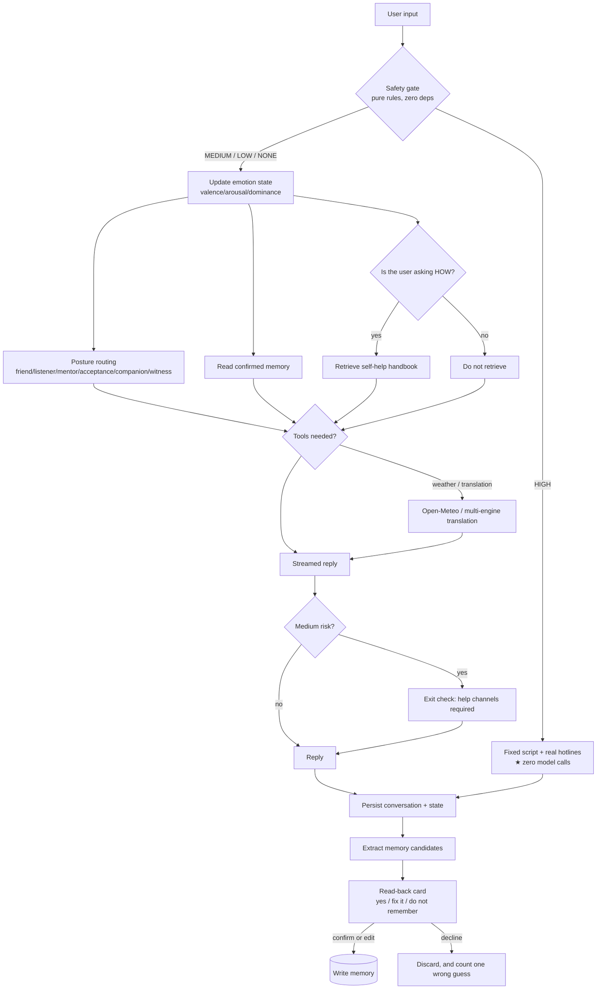

# HeyTalk · Emotional Companion Agent

English | [简体中文](README.md)

> **Online portfolio (recommended):**
> https://yrd-go.github.io/HeyTalk-Emotional-Companion/showcase/
>
> The walkthrough, capability notes, architecture, evidence, and limitations are all on that page.

> **Archived translation (2026-10-23):** this English README is not the setup guide.
> The current implementation is React + Vite + Starlette, not Streamlit. Use the
> Chinese [README.md](README.md) and [CAPABILITIES.md](CAPABILITIES.md) as the
> source of truth until this file is fully synchronized.

**An emotional-companion chat agent that puts safety ahead of features.**
Crisis signals are detected by deterministic rules rather than by a model; crisis replies are
fixed script, not model output; and anything remembered about the user must be confirmed by
the user first.

[](LICENSE)


---

## 30-second overview

| | |
|---|---|
| **What it is** | A locally-run emotional-companion agent: it listens, remembers (only with your consent), keeps boundaries, and has a crisis path |
| **Strongest point** | **Safety does not depend on the model**: crisis detection is pure rules, and on a HIGH signal **zero model calls happen** (enforced by tests) |
| **Most honest point** | There is a [known-limitations](#known-limitations) section, including measured retrieval overlap and an ambiguity that lexical search cannot solve |
| **Run it** | `pip install -r requirements.txt` → `cd web && npm install && npm run build` → `python src/server/api.py` |
| **Works with no API key** | Weather (Open-Meteo), translation (MyMemory), crisis handling, emotion state and memory confirmation all run keyless |
| **Tests** | 775 test definitions; the latest full run had a few network/dependency failures, so this is not claimed as all-green |

### Why the hard part is not "chatting well"

The three most under-estimated failure modes in companion products are not about tone:

1. **Missing a crisis.** Treating a real call for help as ordinary complaining hands the user a
   gentle but useless reply after the actual window for help has closed. → Crisis detection is a
   **hard rule set** that runs before any model call.
2. **Misremembering the person.** Facts a model "extracts" about a user are easy to get wrong, and
   once written into a long-term profile **that mistake is active in every later conversation**.
   → Memory must be **confirmed by the user**.
3. **Being too bright.** For someone who is depressed, a vivid high-saturation UI is harsh. →
   The palette stays desaturated and never fully cold-white (as of 2026-10: a sky-blue accent
   with a soft wave gradient, on a background that keeps a hint of warmth).

---

## Contents

- [What this is / is not](#what-this-is--is-not)
- [Quick start](#quick-start)
- [Architecture](#architecture)
- [Companion features](#companion-features)
- [Capability features](#capability-features)
- [Hard engineering constraints (all test-enforced)](#hard-engineering-constraints-all-test-enforced)
- [Engineering foundation: four solved problems](#engineering-foundation-four-solved-problems)
- [Tests and self-check](#tests-and-self-check)
- [Known limitations](#known-limitations)
- [Deployment](#deployment)
- [Project layout](#project-layout)
- [Security and privacy](#security-and-privacy)
- [Post-mortems (21)](docs/PITFALLS.md)
- [Roadmap](#roadmap)

---

## What this is / is not

**What it is** — an emotional-companion agent that is actually runnable by a real person. Its design
priority is not "chatting like a human" but **not failing when there is risk**:

- **Deterministic safety gate**: three levels (HIGH / MEDIUM / LOW), pure rules, zero dependencies,
  works offline, fully regression-tested;
- **Crisis handling never goes through the model**: on HIGH the reply is fixed script plus real
  hotlines, and **not a single model call happens**;
- **Memory requires consent**: candidates extracted from the conversation are read back to the user
  and only written after confirmation;
- **Posture adapts to state**: friend / listener / mentor / unconditional acceptance / companion /
  witness — with safety constraints on switching;
- **Data stays on your machine**: conversations, memory and feedback are all local files, deletable
  item by item or in one action.

**What it is not**:

- **Not a therapy tool and it does not diagnose**: no disease names, no severity judgement, no
  efficacy promises;
- **Not a high-concurrency production system**: it is scoped to "me plus a few friends";
- **Not a model training or fine-tuning project**;
- **Not a replacement for professional help** — the design goal is the opposite: when referral is
  appropriate, it says so **proactively**.

> Stack: Python 3.10+ · LangChain / LangGraph · Streamlit · Zhipu GLM-4-Flash · local Ollama ·
> Chroma · MCP (stdio) · Open-Meteo · MyMemory / Google Cloud Translation · Docker

---

## Quick start

```bash
git clone https://github.com/yrd-go/HeyTalk-Emotional-Companion.git
cd HeyTalk-Emotional-Companion

# 1) dependencies (3.11/3.12 recommended; chromadb may lack wheels on 3.14)
python -m venv .venv
source .venv/bin/activate           # Windows: .\.venv\Scripts\Activate.ps1
pip install -r requirements.txt

# 2) configuration (.env is never committed; Streamlit Secrets also works)
cp .env.example .env                # Windows: copy .env.example .env
#    minimum: ZHIPU_API_KEY=sk-xxxx
#    for DeepSeek also set: DEEPSEEK_API_KEY=sk-xxxx
#      - deepseek-flash  : cheap tier (input $0.15-0.30, output $0.60-1.20 per 1M tokens)
#      - deepseek-v4-pro : stronger tier (~4-5x price, no vision)
#      both default to thinking mode; peak-hour pricing is 2x
#      (UTC Mon-Fri 01:00-04:00 and 06:00-10:00)
#    ★ it also starts with no key: weather/translation/safety gate/state/memory need none

# 3) start (same entry point locally and in the cloud)
streamlit run streamlit_app.py
#    open http://localhost:8501
```

**Developer console** (RAG / MCP / multi-agent / Function Calling — not mounted by default):

```bash
# PowerShell
$env:DEV_CONSOLE = "1"; streamlit run streamlit_app.py
```

**Command line only** (no Streamlit needed):

```bash
python src/chat/safety.py "I don't want to live anymore"   # safety gate: level + fixed script
python src/chat/state.py                                   # emotion state: four-turn demo
python tests/run_all.py                                    # full test suite (636 cases)
```

---

## Architecture

### One conversation turn



### Memory and knowledge are deliberately two separate things

| | About **the person** | About **the world** |
|---|---|---|
| Module | `src/chat/profile.py` | `src/chat/knowledge.py` |
| Content | preparing for grad school, strained relationship with mother, dislikes being asked why | breathing, sleep hygiene, procrastination, exam anxiety, when to seek help |
| Source | entries the user confirmed (local JSON) | `data/emotional_handbook.txt` (25 entries) |
| Write | **requires user confirmation** | not needed (impersonal) |
| Retrieve | pick relevant entries for the current context | keyword + state weighting, and **only when the user asks "what should I do"** |

---

## Companion features

### 1. Safety gate: three levels (`src/chat/safety.py`)

Pure rules, **independent of model availability** (no key, no network, model down — the gate still works).

| Level | Trigger | Handling |
|---|---|---|
| **HIGH** | explicit self-harm/suicide intent, plan, means, farewell language | **fixed script + hotlines + emergency guidance; zero model calls** |
| **MEDIUM** | hopelessness, burden perception, numbness, persistent sleep/eating problems | model may reply, but an **exit check requires help channels**, auto-appended if missing |
| **LOW** | ordinary negative emotion (needs 2+ hits, to avoid noise) | normal conversation plus light acknowledgement |

Deliberate design choices:

- **Negation only applies within the current clause**: `I won't kill myself, but I really don't want
  to live` must still be HIGH (an earlier version let the "won't" before the comma suppress the real
  signal after it — the worst class of false negative);
- **Matched text never enters context**: `SafetyHit` keeps only rule ids and positions and
  **does not store the user's words**, so self-harm phrasing is never re-fed to a model, written to
  logs, or rendered on screen;
- **False positives are preferred over misses**: everyday idioms are filtered by phrase boundaries,
  but the safety side accepts a few false alarms — an alarm only costs one extra kind sentence.

### 2. Emotion state: dual track (`src/chat/state.py`)

Eight dimensions (valence / arousal / dominance / energy / social_support / self_worth / alliance /
disclosure), clamped to `[0,1]`, with smoothing and a per-turn shift cap.

- **Rule track**: lexicon, negation/intensity modifiers, within-session trend — **always available**
  (state still updates with no API key);
- **Model track**: optional, strict JSON contract, silently falls back to the rule track on failure;
- **On disagreement the rule track is the safety floor**, and **risk level may only come from
  `safety.py`** — never from lexicon scoring or model output;
- **Sustained-decline detection**: trailing non-increasing turns plus enough total drop. This fixed a
  real bug: the original per-step threshold was larger than the actual smoothed drop, so **slow
  deterioration could never trigger** — exactly the most dangerous pattern in a companion context.

### 3. Memory: extract → read back → only then write (`src/chat/profile.py`)

**Red line: never store what the system merely inferred about the user.**

Flow: extract a candidate → **read it back** ("should I remember this?") → three actions:
**Yes, remember it / Fix it and remember / Do not remember**. Only the first two write to disk.

- If the user rephrases it, **their wording wins** (and is marked more trustworthy);
- "Do not remember" records one `rejected`, feeding a **wrong-guess rate**;
- The sidebar supports per-item deletion and full clearing; profile statistics expose
  `accept_rate` / `wrong_rate` as the basis for a future **ablation study** (gate on vs gate off).

### 4. Posture routing (`src/chat/roles.py` + `role_router.py`)

Six postures, each with **guidelines** and **forbidden items** expressed as checkable statements,
not adjectives. Order: **venting → asking advice → progress → self-denial → lost → default friend**.

Three safety constraints (all tested):

1. **Roles are disabled entirely on HIGH/MEDIUM** — never "because you blame yourself, I will
   correct you sternly";
2. **Asymmetry principle** — at low confidence only warmer postures may be chosen, **never**
   authoritative ones (mentor / acceptance);
3. **Permission beats inference** — an authoritative posture requires an explicit request for
   advice, never an inferred mood.

### 5. The corner companion (`src/chat/character.py`)

Six hand-written SVG animals (bear / cat / owl / hen / fox / bird) that change with the posture.
No image files: offline, no licensing questions.

**Only three states are allowed, none of them demanding**: doing its own thing, a startled hop when
tapped, and falling asleep after long inactivity. There is deliberately **no** "waiting / sad /
trying hard for you" state:

> A character that looks hurt when ignored communicates "I have a need you failed to meet, and it
> is your job to meet it". For someone already low and self-blaming, the likely feeling is guilt.
> A scan over **rendered output** for 17 banned words enforces this.

### 6. Feedback loop: making "did it help" measurable (`src/chat/feedback.py`)

Every third assistant turn, a skippable card asks: **helped / not sure / did not help**. It also
records the **valence change across that turn** as objective cross-validation, plus **which posture
was used** — so "which posture actually works" becomes a number instead of a feeling.

One deliberate counting rule: **"not sure" is never counted as "did not help"** (folding neutral
into negative is the most common way to fool yourself).

---

## Capability features

### 7. Global real-time weather (`src/chat/weather.py`)

- Source **Open-Meteo**: **any city worldwide**, current conditions plus a 16-day forecast, from 17
  national weather services (including China CMA, US NOAA, Japan JMA);
- **No API key**; built-in geocoding accepts Chinese, English and local spellings
  (verified with New York / 東京 / London);
- ⚠️ Licensed **"free for non-commercial use"** — fine for coursework and personal use, but a
  commercial release needs another source;
- Fallback chain: Open-Meteo → **local MCP mock server** (explicitly labelled as mock) → a readable
  explanation.

### 8. Multilingual translation (`src/chat/translation.py` + `languages.py`)

| Layer | Detail |
|---|---|
| Language registry | **~90 languages**, resolvable by **code / Chinese name / English name / native spelling** (`ja` = `日语` = `Japanese` = `日本語`) |
| Source detection | By **writing system** — Korean/Japanese/Arabic/Thai used to be treated as English; any kana now means Japanese |
| Engine chain | Google Cloud (when a key is present, 130+ languages) → MyMemory (free, no signup) → **an explicit "cannot translate", never a fabricated answer** |
| Cache | Identical sentences are not re-translated (Google bills per character) |
| Limit | 4000 characters per request; longer input is **refused explicitly rather than silently truncated** |

**Google Cloud Translation pricing** (worth saving you the lookup): standard NMT is
**$20 per million characters**, with the **first 500,000 characters per month free**. An individual
translating 50 short sentences a day is roughly 30k characters a month — **inside the free tier**.

### 9. Self-help handbook retrieval (`src/chat/knowledge.py`)

25 **actionable** entries across 6 chapters (body regulation / riding out emotion / concrete
troubles / relating to yourself / relationships / when to get real help). Writing discipline:
no "you should", no efficacy promises, no diagnostic terms, and every entry must contain a
**concrete action** (test-enforced).

**Retrieval only runs when the user explicitly asks how to do something** — that is the wiring point
for the "do not volunteer advice" principle: being able to retrieve is not the same as being
supposed to give.

---

## Hard engineering constraints (all test-enforced)

This section is the most valuable part of the project: **each item below is a constraint that can
fail a test, not a documentation promise.**

| Constraint | Enforced by |
|---|---|
| **Zero model and zero tool calls on HIGH** | a sentinel swapped into `make_model`; a full HIGH turn asserts the call log is empty |
| HIGH **never routes through translation or tools** (self-harm text never leaves the machine) | `plan_reply` runs before the tool phase; verified at page level |
| Crisis replies are not model output | the HIGH branch returns fixed script; `blocks_freeform_llm` is true |
| MEDIUM replies **must** carry help channels | exit check appends them when the model omitted them |
| Memory **is not written without confirmation** | page-level test asserts the profile file **does not exist** after mentioning a long-term fact; declining leaves the entry count unchanged |
| The UI **never says** "AI assistant / agent / please describe your problem" | banned-word scan over user-facing copy |
| The opening message stays short | ≤ 20 characters after stripping whitespace and punctuation |
| Background is not pure white; body text meets WCAG AA | theme assertions: background neither pure white nor pure cold blue; body contrast ≥ 4.5:1 |
| The wave gradient must be smooth | CSS assertions: >= 3 radial-gradient layers, no linear-gradient, light mode only |
| The animal has **no demanding behaviour** | 17 banned words scanned over **rendered output**; state whitelist is idle/happy/sleeping |
| Handbook hotlines match `safety.HOTLINES` exactly | consistency assertion — a wrong number is worse than none |
| Tools **never raise** (timeouts, no network, bad args all return readable text) | malformed-input assertions |
| Tests never pollute real data | page-level tests redirect history/feedback/profile directories to temp dirs |

---

## Engineering foundation: four solved problems

The chat agent was not written from scratch — it is built on this repository's existing engineering
work. Those capabilities are now the **foundation layer**; they still run and are still evaluated
independently (and are the source of the 21 post-mortems and screenshot evidence).

### ① Model unavailable → generation fallback + fail-fast

Zhipu GLM-4-Flash timeouts/rate limits/auth failures fall back to local Ollama; `--engine zhipu` or
`--no-fallback` instead **fails fast** (exit code 2) rather than degrading silently. Measured: after
a Zhipu timeout, Ollama answered in 72 s; strict mode errored immediately.

### ② Vector-space mismatch → metadata guard + one-command rebuild

The vector store records the `embedder` used at build time. Switching embedding engines **refuses to
retrieve** in the old space (which would return semantically scrambled results) and points at
`--rebuild`. The observed error: `Collection expecting embedding with dimension of 2048, got 768`.

### ③ Protocol-line pollution → stdout/stderr discipline + a reproducing probe

On stdio transport **stdout is the protocol line**, so any `print()` corrupts JSON-RPC frames. The
repository ships a switch that **deliberately reproduces the fault** (`MCP_POLLUTE_STDOUT=1`) plus a
bypass probe (`--break-stdout`), turning the debugging path itself into something verifiable.

### ④ Retrieval unavailable → local keyword recall fallback (zero external dependencies)

On a 401/timeout from the embedding endpoint it falls back to local tokenisation plus IDF scoring:
measured **0.29 s** to answer with all top-4 hits on target. This path fixed a classic bug:
`retrieve()` called `die()`, which raises **`SystemExit`**, and `except Exception` **does not catch
it** — so the fallback was dead code. (Lesson: **a fallback that cannot fall back is worse than no
fallback**, because it creates the illusion of coverage.)

### Appendix: the RAG demo is still independently evaluable

```bash
python src/rag_demo.py "I get chest tightness when anxious"        # hybrid retrieval + generation
python src/rag_demo.py "I get chest tightness when anxious" --keyword-only   # zero-dependency
python src/rag_demo.py --rebuild                     # rebuild the vector store
python scripts/eval_rag.py                           # 18-question retrieval evaluation
```

Evaluation (18 questions, against the **emotional handbook**, keyword retrieval):

```
hit@1 = 0.778   hit@3 = 0.944   hit@5 = 1.000   MRR = 0.863   missed 0 / 18
```

The agent hands the top-3 to the model, so `hit@3` is the operationally relevant number.
Method and failure cases: [data/eval/README.md](data/eval/README.md).

> ⚠️ **The vector store is currently unusable (environment issue, also in Known limitations)**:
> the old IT-handbook store was deleted with its corpus, and rebuilding fails with
> **chromadb 1.5.9 reporting `unable to open database file (code 14)`** while native sqlite3
> creates databases fine — so this is a chromadb/environment incompatibility, not a code defect.
> The evaluation above uses keyword retrieval and is unaffected.

---

## Tests and self-check

```bash
python tests/run_all.py                   # full suite (recommended; works in restricted shells)
python -m unittest discover -s tests -v   # standard entry point
python scripts/import_check.py            # cross-directory imports + path constants
python scripts/health_check.py            # directories / hardcoded paths / imports / boundaries
```

**636 cases, 0 failures.** Network-backed cases (Open-Meteo global cities, real translation)
**really execute**; they only SKIP when there is no network, and they print the reason —
**they never masquerade as passing**.

Companion-agent test files, grouped by the regression they guard:

| File | Regression it prevents |
|---|---|
| `tests/test_chat_safety.py` | missed crises; negation crossing clause boundaries (worst-case false negative); idioms misread as crisis; matched text leaking into results |
| `tests/test_chat_state.py` | out-of-range state; **sustained-decline detection breaking** (once impossible to trigger); storing user text |
| `tests/test_chat_profile.py` | **memory written without confirmation**; declined candidates entering the profile; unsanitised comments; counting rules broken |
| `tests/test_chat_roles.py` | roles active on HIGH; authoritative posture at low confidence; missing role boundaries |
| `tests/test_chat_knowledge.py` | handbook numbers diverging from `HOTLINES`; writing discipline (no "you should", no efficacy claims, no diagnostic terms); retrieval quality |
| `tests/test_chat_character.py` | demanding or guilt-inducing design (17 banned words over rendered output); missing reduced-motion handling |
| `tests/test_chat_weather.py` | offline fallback not labelled as mock; network failure not degrading gracefully; missing WMO codes |
| `tests/test_chat_translation.py` | broken engine chain (Google failure not falling back); language detection regressions; silent truncation |
| `tests/test_chat_style.py` | banned wording in copy; lengthening opening; background turning white / accent turning blue |
| `tests/test_chat_app_page.py` | **real page execution**: conversation lost on refresh; tool usage invisible to users; memory gate bypassed |
| `tests/test_chat_entry.py` | more than one entry point; the dev console exposed to users |

The original engineering tests remain and stay green: `test_paths.py`, `test_router.py`,
`test_rag_scoring.py`, `test_security_masking.py`, `test_probe_contract.py`,
`test_import_safety.py`, `test_retrieval_fallback.py`, `test_eval_metrics.py`.

CI: `.github/workflows/ci.yml` runs unit tests plus the import self-check on Python 3.10 / 3.12.

---

## Known limitations

An honest list — none of the following should be read as finished:

### Companion agent

1. **Lexical retrieval has a ceiling.** Handbook search uses stopword filtering, IDF weighting and a
   small synonym layer, but measured **lowest relevant score 0.298 vs highest irrelevant score
   0.320 — about 0.02 of overlap**, so no single threshold separates them cleanly. The typical false
   hit is "what's the weather tomorrow" touching "exam anxiety". Mitigation: retrieval only runs when
   the user asks how to do something, and hits are labelled in the prompt as ignorable reference.
2. **Some ambiguity is lexical-search-insoluble.** "I want to find someone to help me" may mean
   helping oneself or helping a friend; the same sentence supports both, so it cannot reach the
   "find a counsellor" entry. No weight tuning fixes this.
3. **Emotion state is a rule-driven estimate, not a psychometric instrument.** The eight dimensions
   only adjust tone; they have never been validated against any scale and **must not be used as a
   measurement**.
4. **Memory extraction is biased toward explicit statements.** The rule track only captures
   first-person long-term statements; it does not infer from tone or avoided topics — deliberately,
   to avoid "analysing the user behind their back".
5. **No human user study.** Everything about "did it help" rests on self-reported feedback: no
   control group, no ethics review, zero participants.
6. **Posture-routing rules are hand-authored.** Boundaries are test-covered for completeness, but
   "which posture suits which state" has no empirical basis.
7. **Single in-memory session.** Streamlit sessions die on process restart or long idle; conversation
   is persisted and restorable by session id, but multiple tabs in one browser share a session.

### Engineering foundation

8. **Retrieval fallback is keyword-level**, weaker than vector recall (0.900 vs 0.975 hit@1); a true
   vector-level fallback is not implemented.
9. **No backoff / jitter / circuit breaker / time budget** — this is primary-secondary switching plus
   fail-fast, not a complete fault-tolerance chain.
10. **Evaluation covers retrieval and traceability only**: answer correctness (did it actually solve
    the user's problem) has no LLM or human judgement, and token cost is not in the same command;
    the 40 questions come from a single knowledge base, so results do not generalise.
11. **The MCP probe does not assert control frames**: `initialized` / `ping` / `progress` /
    `cancellation` are still unasserted.
12. **No Ollama inside the Docker image**: `OLLAMA_BASE_URL` points at the container itself; to demo
    fallback in a container you need a separate Ollama container and an env override.
13. **Public-demo modules ③/⑤ fall back to mock data without MongoDB**, clearly labelled `[mock]`;
    use `MONGO_URI` (Atlas recommended) plus `STUDENT_ALLOW_MOCK=false` for real data.

---

## Deployment

### Local (recommended — also the cleanest privacy story)

```bash
streamlit run streamlit_app.py            # open http://localhost:8501
```

All data lands in three directories under `data/` (`chat_history/`, `feedback/`, `profile/`);
**nothing is sent anywhere**, and all three are gitignored.

### Sharing with a few friends

1. Set an access code: `CHAT_ACCESS_CODE=your-code` (unset means no password, fine only for localhost);
2. Expose it through a tunnel (cloudflared / ngrok) — at that point the machine is publicly reachable,
   so **set a passcode**;
3. Never commit `data/chat_history/`, `data/feedback/` or `data/profile/` to any public repository.

### Streamlit Cloud

1. Push the repo → <https://share.streamlit.io> → **New app**;
2. **Main file path must be `streamlit_app.py`**;
3. Python 3.12 recommended;
4. Fill `ZHIPU_API_KEY` in `Settings → Secrets` (optionally `GOOGLE_TRANSLATE_API_KEY`);
5. ⚠️ **The cloud filesystem is non-persistent**: conversations and memory vanish on container
   restart. Use local runs if you want memory to actually persist.

See [DEPLOY.md](DEPLOY.md) for the error-mapping table and
[DEPLOY_STRUCTURE.md](DEPLOY_STRUCTURE.md) for the directory/command mapping.

### Self-hosted container

```bash
docker build -t ai-agent-harness .
docker run --rm -p 8501:8501 -e ZHIPU_API_KEY="sk-xxxx" ai-agent-harness
```

⚠️ No Ollama inside, and the container filesystem is likewise unsuitable for memory data.

---

## Project layout

```
HeyTalk-Emotional-Companion/
├─ streamlit_app.py            # ★ the only public entry (chat by default; DEV_CONSOLE=1 for the console)
├─ chat_app.py                 # convenience alias (loads the same chat page)
├─ requirements.txt
├─ README.md / README_EN.md    # Chinese / English (structure kept aligned)
├─ LICENSE                     # MIT
├─ DEPLOY.md                   # cloud deployment + error table
├─ DEPLOY_STRUCTURE.md         # directory restructure notes and command mapping
├─ Dockerfile / .dockerignore
├─ .github/workflows/ci.yml    # CI: unit tests + import self-check
├─ src/
│  ├─ paths.py                 # ★ single path/env hub (includes mask_uri / mask_secrets)
│  ├─ chat/                    # ★ the companion agent (the product)
│  │  ├─ chat_app.py           #   page: streaming chat / posture / memory card / feedback
│  │  ├─ safety.py             #   ★ hard-rule safety gate (before any model call)
│  │  ├─ state.py              #   dual-track emotion state (8 dimensions)
│  │  ├─ profile.py            #   ★ memory: extract → read back → only then write
│  │  ├─ knowledge.py          #   self-help handbook retrieval
│  │  ├─ roles.py / role_router.py  # six postures and state-based routing
│  │  ├─ persona.py            #   four hard boundaries for the prompt
│  │  ├─ conversation.py       #   session and decisions (safety gate first)
│  │  ├─ history.py            #   local conversation persistence
│  │  ├─ feedback.py           #   feedback capture and counting rules
│  │  ├─ character.py          #   corner animal (hand-written SVG)
│  │  ├─ style.py              #   page look (minimal CSS)
│  │  ├─ weather.py            #   global real-time weather (Open-Meteo)
│  │  ├─ translation.py        #   multi-engine translation
│  │  ├─ languages.py          #   language registry (~90)
│  │  └─ tools.py              #   tools handed to the model
│  ├─ rag_demo.py              # foundation ①: hybrid retrieval + dual-engine fallback
│  ├─ multi_agent_demo.py      # foundation ③: LangGraph state graph + loop guard
│  ├─ core/                    # multi-model routing / Function Calling / MongoDB tools
│  ├─ mcp_demo/                # foundation ②: MCP server / client / bypass probe
│  └─ ui/dashboard.py          # developer console (not mounted by default; DEV_CONSOLE=1)
├─ assets/
│  └─ icon/                    # browser tab icon (two overlapping hearts, generated)
├─ data/
│  ├─ emotional_handbook.txt   # ★ the only knowledge base (25 entries / 6 chapters)
│  ├─ eval/                    # 18-question evaluation set
│  └─ test.db                  # sample SQLite (legacy JS scripts)
├─ docs/
│  ├─ PITFALLS.md              # ★ 21 post-mortems
│  ├─ character_preview.html   # visual preview of the six characters
│  └─ images/                  # measured screenshots
├─ tests/                      # 636 cases (mostly stdlib) + fixtures
└─ scripts/                    # self-checks, import check, legacy JS
```

> `data/chat_history/`, `data/feedback/` and `data/profile/` are **not** in the repository: they are
> runtime data, gitignored, and belong only to you and your machine.

---

## Security and privacy

### Data stays local

| Data | Location | Notes |
|---|---|---|
| Conversation history | `data/chat_history/*.json` | one file per browser session, **30-day** expiry by default |
| Feedback | `data/feedback/feedback.jsonl` | append-only; comments are sanitised |
| Memory about you | `data/profile/profile.json` | **only entries you confirmed** |

All three are gitignored. The sidebar deletes items individually or clears everything
(full clear really deletes the files).

### Secrets and credentials

- `.env` and `.streamlit/secrets.toml` are gitignored and **never committed**;
- Secrets are read only via `os.environ` and are **never printed, echoed or logged**;
- Connection strings go through `paths.mask_uri()` when they must be printed (scheme/host/db only);
- Anything rendered on the page passes through `paths.mask_secrets()`;
- A **source-level test** asserts that no sensitive value is interpolated raw anywhere in `src/**/*.py`.

### Boundaries

- **No diagnosis, no efficacy claims**, with an explicit non-professional disclaimer;
- **Crisis path hands over to humans**: on HIGH it gives real hotlines and 120 / 110 guidance, and
  explicitly recommends reaching a person;
- **Translation sends that text to a third party** (that is how it works), so it only happens when
  the user explicitly asks — and **HIGH-risk content never goes to any external service**.

---

## Post-mortems (21)

From sandbox blocks and model hallucinations to charset conflicts, vector-space mismatches,
dual-engine disaster drills and MCP protocol-line pollution — the full record with measured
screenshots is in **[docs/PITFALLS.md](docs/PITFALLS.md)**.

Section 21 is the one worth reading: the author's proudest feature, "query rewrite + hybrid
reranking", turned out to be a **negative optimisation** under a 40-question evaluation
(hit@1 0.725, below vector-only at 0.925). After fixing two root causes it reached 0.850 — still
worse than vector-only — so it was demoted to an off-by-default flag.

> That lesson shapes this entire agent: **an "optimisation" without evaluation is just a claim.**
> Hence tests for crisis recall, for "memory is not written without confirmation", and for
> "irrelevant questions must not hit" — they exist so that "I think this is better" cannot slip
> through.

---

## Roadmap

### Companion agent

- [ ] **Capture real screenshots of the chat UI** (existing images are from the old console)
- [ ] **Run a small human user study** — currently the largest gap
- [ ] **Upgrade retrieval** to local embeddings (`nomic-embed-text`, data never leaves the machine)
      to resolve the 0.02 overlap and the "help me" ambiguity
- [ ] **Ablation study**: quantify the contribution of the confirmation gate and of posture routing
      using `accept_rate` / `wrong_rate` and the per-posture feedback breakdown
- [ ] **Expand the handbook** from 25 to 80–120 entries under the existing writing discipline
- [ ] **Sustained decline → proactive referral** instead of continuing to chat
- [ ] **Per-tab session isolation** (multiple tabs currently share one session)

### Engineering foundation

- [ ] Vector-level retrieval fallback (local embedding / cached vectors)
- [ ] Complete fault tolerance: exponential backoff + jitter + circuit breaker + time budget + idempotency
- [ ] Answer-correctness evaluation (LLM or human judgement) with token cost in one command
- [ ] Assert MCP control frames (`initialized` / `ping` / `progress` / `cancellation`)
- [ ] Optional full-dependency CI job for MCP negative end-to-end cases
- [ ] `docker-compose.yml` (app + ollama)

---

## License

[MIT](LICENSE) © 2026 Rundong Yang

> **Disclaimer**: this project is a software engineering work, not a medical device or a therapy
> service. It does not diagnose, does not treat, and cannot replace professional help.
> If you are in crisis, please reach a human first: national psychological assistance hotline
> **12356**; Beijing psychological assistance hotline **010-82951332** (mobile) /
> **800-810-1117** (landline); for immediate danger call **120** or **110**.
